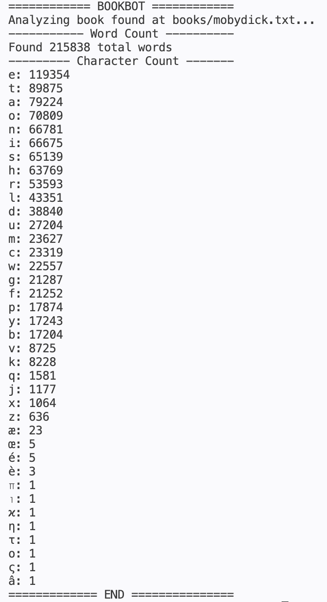

# bookbot
BookBot is my a python project as part of [Boot.dev](https://www.boot.dev)'s Data Analyst Accreditation.



**Table of Contents**

- [Execution / Usage](#execution--usage)
- [Technologies](#technologies)
- [Features](#features)
- [Author](#author)
- [Change log](#change-log)


## Execution / Usage

To run bookbot make a copy of this repo on your local device. You will need Python3. With a text (.txt) of your choice - bookbot can run a local analysis of the file:

```sh
$ python3 main.py books/mobydick.txt
```

## Technologies

bookbot uses the following technologies and tools:

- [Python](https://www.python.org/): 

## Features

bookbot currently has the following set of features:

- checks number of words
- checks number of characters and produces a dictionary of them

## Author

Hariz Higgs – harizhiggs@pm.me

## Change log

- 0.0.1
    * First working version
